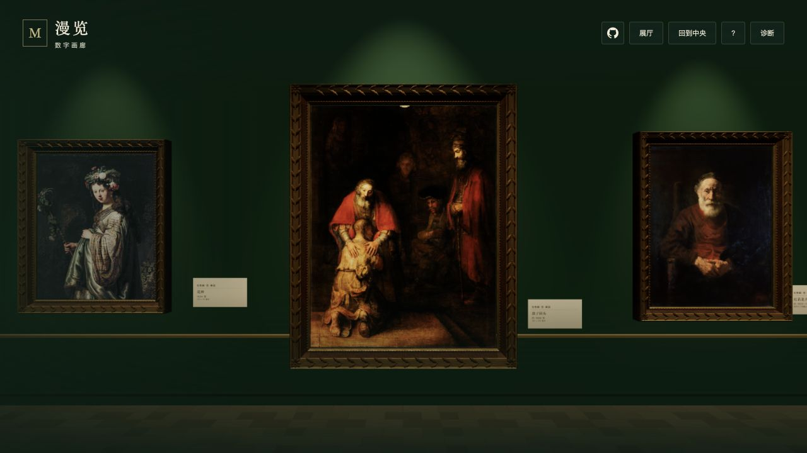
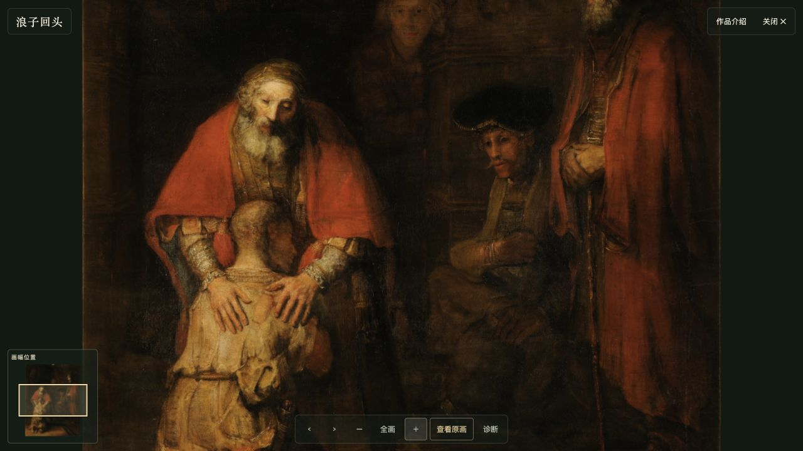
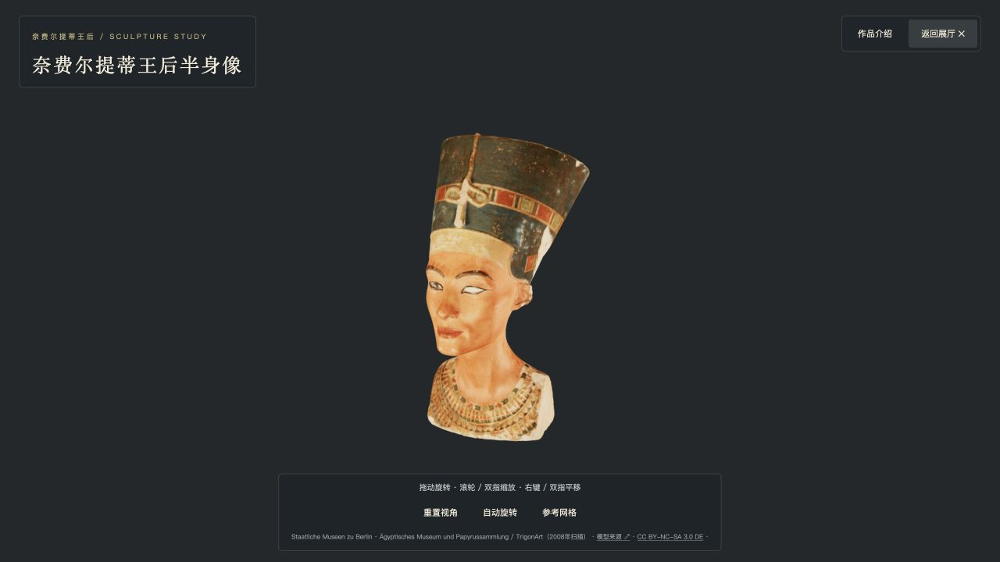

# 漫览画廊

一座可以在浏览器里慢慢逛的数字画廊。走进展厅，靠近一幅画，放大看笔触；绕到雕塑的另一面，再读一读作品背后的故事。

**五个连通展厅 · 22 幅绘画 · 2 件雕塑**

[进入画廊 →](https://anonbug.github.io/art-gallery/)

无需安装或注册。打开链接就是展厅，可以从眼前的作品开始，也可以通过右上角「展厅」选择感兴趣的空间。

*画廊实景：在作品之间走动，也可以停下来细看。*

## 这里收录了什么

从伦勃朗笔下的明暗与情感，到斯奈德斯丰盛的市场与厨房，再到达芬奇的肖像和两件雕塑，五个展厅提供了不同的观看起点。

| 展厅 | 内容 | 可以看到的作品 |
| --- | --- | --- |
| **光与归途** | 伦勃朗相关馆藏，9 幅绘画 | 《浪子回头》《达娜厄》《花神》《大卫与约拿单》等 |
| **丰盛的日常** | 斯奈德斯主题，8 幅绘画，含合作及工作室作品 | 《鱼摊》《水果摊》《猎物摊》《蔬菜摊》等 |
| **无尽的凝视** | 达芬奇主题，5 幅绘画 | 《蒙娜丽莎》《抱银貂的女子》《圣母子与圣安娜》《贝努瓦圣母》《丽塔圣母》（归于达芬奇） |
| **石中的回声** | 米开朗基罗，1 件雕塑 | 《蹲伏的男孩》 |
| **蓝冠下的凝望** | 古埃及彩绘雕塑，1 件雕塑 | 《奈费尔提蒂王后半身像》 |

这是一场数字策展。展厅把不同馆藏中的作品放在一起欣赏；作品介绍保留作者归属、来源与署名信息，包括「工作室」和「归于」等说明。

## 怎么浏览

### 先逛一圈

电脑上点击「开始漫游」，就可以移动鼠标环顾、用 **WASD 或方向键**走动；按 **Esc** 显示鼠标并暂停。手机上用左下角的摇杆移动，拖动屏幕环顾。

看向地板，出现光圈后点击，就会自动走到那里。展厅之间的门洞可以直接穿行；想快速换个主题，点击右上角「展厅」，预览后选择「前往展厅」即可。

### 走近画作，放大细看

1. 点击一幅画，先走到它面前。
2. 到达后再点同一幅，打开高清细看。
3. 用滚轮或双指缩放，拖动查看局部；点击「全画」回到完整画面。

左下角的小地图会标出当前看的位置，也可以用它快速移动到画面的另一处。想接着看其他作品，可以使用上一幅、下一幅按钮。部分作品还提供「查看原画」，用来浏览画廊收录的更高分辨率图像。

*高清细看：从完整构图走向画面中的细节。*

### 绕着雕塑看一看

点击雕塑本体，打开可以自由旋转的 3D 细看。拖动旋转，滚轮或双指缩放，右键拖动或双指平移；也可以开启自动旋转，让轮廓慢慢从眼前经过。

*雕塑细看：换一个角度，观察面部、冠缘和颈部的轮廓。*

### 读一读作品的故事

点击画框旁或雕塑底座上的**展签**，会直接打开作品介绍。里面有背景故事、观看线索，以及图像或模型的来源和许可信息。高清细看和雕塑细看里也有「作品介绍」入口，关闭后可以继续欣赏。

## 特别鸣谢

**特别感谢 [justdataplease/art-history-museum](https://github.com/justdataplease/art-history-museum) 项目及其作者。**

本画廊的浏览器漫游、靠近画作后驻足欣赏，以及通过展签阅读作品信息的体验，参考了这个项目。感谢作者分享这座可以走进去的艺术博物馆，为漫览画廊提供了重要启发。

也感谢博物馆、Wikimedia Commons 和数字扫描贡献者提供作品资料与数字资源。画廊在作品介绍中保留对应的来源、署名与许可信息。

## 给想继续了解的人

- [参观在线画廊](https://anonbug.github.io/art-gallery/)
- [反馈问题或提出建议](https://github.com/AnonBug/art-gallery/issues)
- [技术文档](docs/TECHNICAL.md)：本地运行、资源处理、架构、维护与部署
